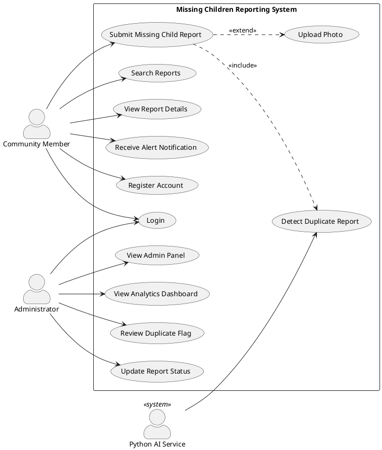
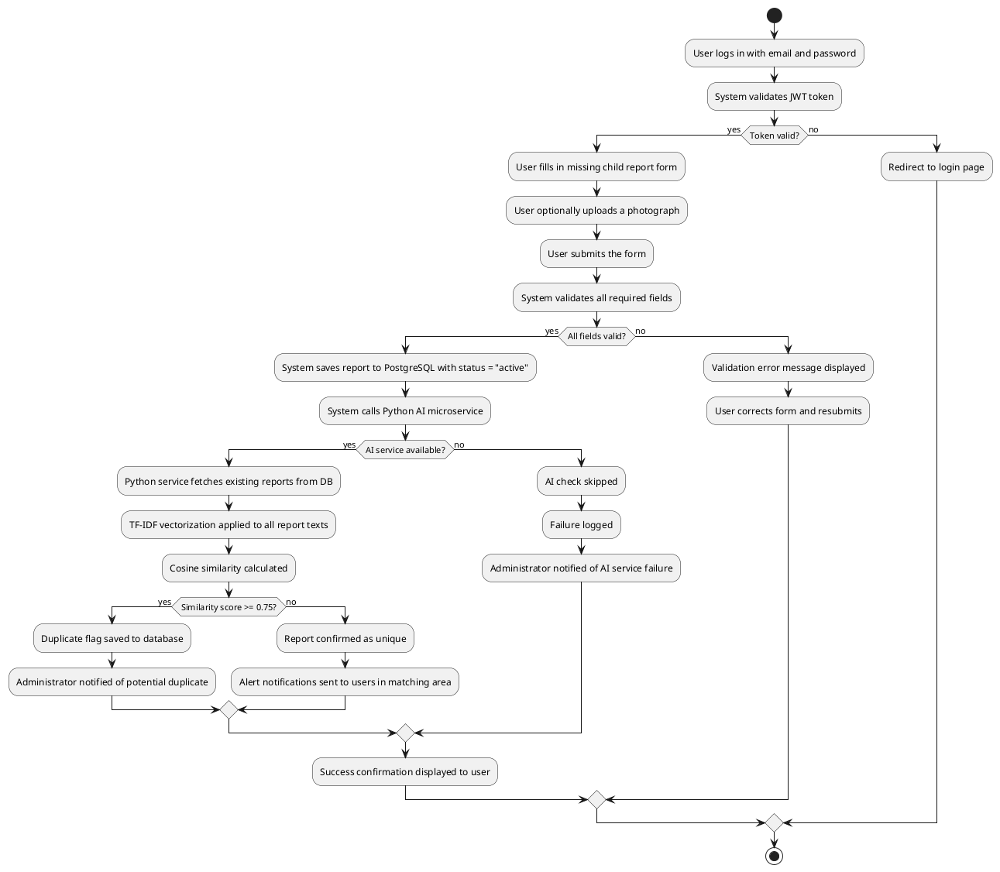
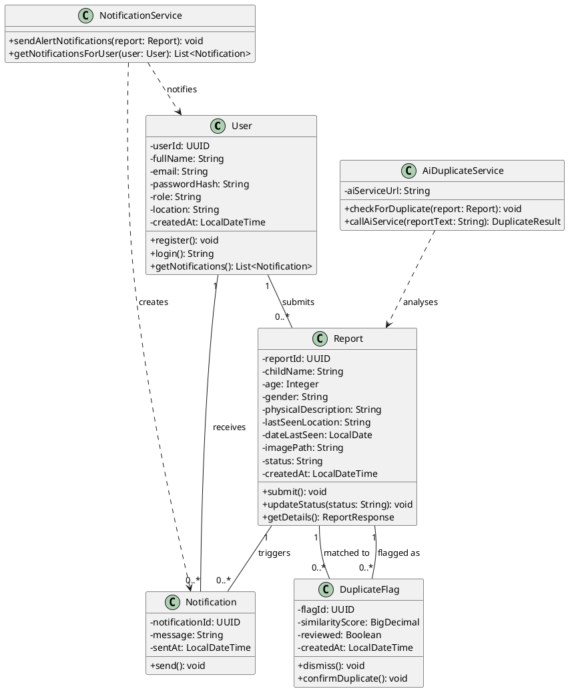
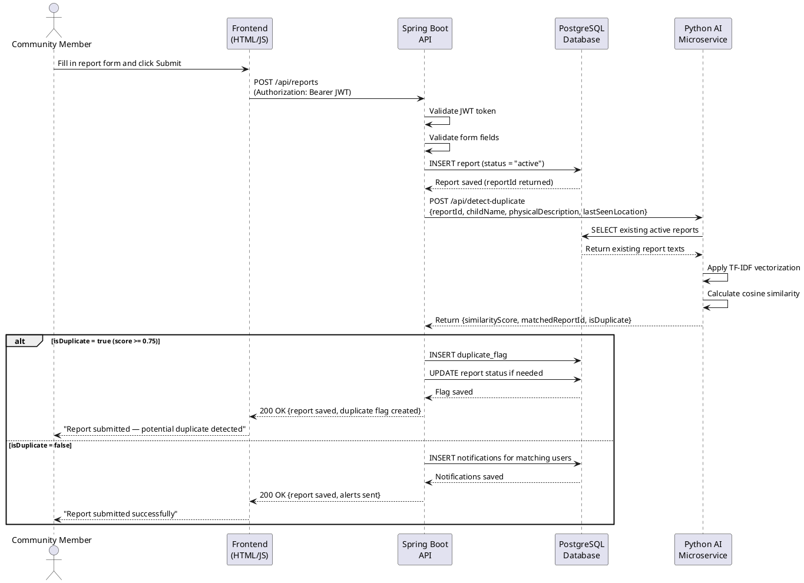

# ISJ107V — Assignment 2: Formal System Proposal and Specification

**Tshwane University of Technology**
**Faculty of Information and Communication Technology**
**Department of Computer Science**

**Module:** ISJ107V — Integrated Software Project 2026
**Assignment:** Assignment 2 — Formal System Proposal and Specification
**Student Name:** Ntwanano Mathebula
**Student Number:** 216080254
**Tut4life Email:** 216080254@tut4life.ac.za
**Lecturer:** Dr HD Masethe
**Due Date:** 19 September 2026

---

## Declaration of Originality

I, Ntwanano Mathebula (Student Number: 216080254), declare that this assignment is my own original work. All sources have been acknowledged using the Harvard referencing method as required by TUT policy RIPPOL067.

**Signature:** _____________________ **Date:** _______________

---

## Question 1 — Project Introduction [8 marks]

### 1.1 Project Title, Description, Intended Users and Emerging Technology (2 marks)

**Project Title:** AI-Enhanced Community-Based Missing Children Reporting and Tracking System

**Description:**
The proposed system is a centralized web-based platform that enables South African community members to report missing children, search active cases, upload identifying photographs, and receive geographic alert notifications. The system addresses the current fragmentation of missing children information across disconnected channels such as WhatsApp groups, social media, and police stations by providing a single, structured digital platform for reporting and response coordination.

**Intended Users:**
- Community members — submit and search missing children reports
- Administrators — review AI-flagged duplicate reports, update case statuses, monitor analytics
- System (automated) — AI duplicate detection engine, notification dispatcher

**Emerging Technology:**
The system integrates Artificial Intelligence and Machine Learning (AI/ML) in the form of Natural Language Processing (NLP)-based text similarity analysis. A Python microservice uses TF-IDF vectorization and cosine similarity to automatically detect when two submitted reports likely refer to the same missing child. This reduces duplicate data and improves the accuracy of information available to the community.

---

### 1.2 Problem Statement (3 marks)

South Africa records approximately 1 697 missing children cases annually — roughly one every five hours (Missing Children South Africa, 2024). Despite this, no centralized digital platform exists for communities to report and track these cases.

**Current Problem:**
Information about missing children is shared through fragmented, unconnected channels — WhatsApp groups, Facebook posts, police station visits, and word of mouth. These channels do not communicate with each other, which means the same case is frequently reported multiple times with conflicting details, critical information reaches community members too slowly, and no mechanism exists to identify patterns or automatically alert people in the affected area.

**Who is Affected:**
- Community members who rely on scattered, unreliable information to respond to missing children cases
- Families of missing children who cannot consolidate information about their child's case
- Community organisations and law enforcement who cannot analyse reporting trends or coordinate responses effectively

**Consequences of Leaving it Unresolved:**
Every month without a better system means approximately 140 children are reported through fragmented channels (derived from Missing Children South Africa, 2024). Delayed and duplicated information directly reduces the chances of locating a missing child in the critical early hours. The longer this problem goes unaddressed, the more community response efforts are undermined by poor data quality and slow information flow.

---

### 1.3 Project Aim, Objectives, Scope and Success Criteria (3 marks)

**Project Aim:**
To develop and deliver a functional AI-enhanced web-based platform for reporting, tracking, and analysing missing children cases in South Africa, ready for live demonstration by November 2026.

**Three Measurable Objectives:**
1. Develop and deploy a web-based reporting platform by June 2026 that allows registered users to submit missing children reports with all required fields and optional image upload, verified by at least one complete end-to-end report submission with no errors.
2. Implement an AI-based duplicate detection module by June 2026 that achieves a cosine similarity detection precision of at least 80%, measured against a test dataset of 20 known report pairs.
3. Deliver an analytics dashboard by June 2026 displaying at least three distinct reporting trend views — by location, by month, and by resolution status — sourced from live database data.

**Main Scope Boundaries:**

In Scope:
- Web-based user registration, login and authentication
- Missing children report submission with optional image upload
- Geographic alert notifications to registered users
- AI-based duplicate report detection using NLP text similarity
- Analytics dashboard displaying reporting trends
- Administrator panel for duplicate review and status management

Out of Scope:
- Integration with SAPS or police databases
- Facial recognition technology
- GPS tracking of children
- Mobile application development (Android/iOS)

**Two Success Criteria:**
1. The system successfully accepts, stores, and displays at least one complete missing children report end-to-end without errors, with all required fields validated and the AI duplicate check completing within 2 seconds.
2. The AI duplicate detection module correctly identifies at least 80% of duplicate reports in a prepared test dataset, and the analytics dashboard displays accurate reporting trends by location and time period sourced from live data.

---

## Question 2 — System Requirements [15 marks]

### 2.1 Ten Prioritized Functional Requirements (10 marks)

| ID | Priority | Requirement | Acceptance Criterion |
|---|---|---|---|
| FR-01 | Must | The system shall allow an authenticated user to filter active missing children reports by gender, age range, and geographic area simultaneously on the dashboard. | Given filter values are selected, when the filter is applied, then only reports matching all selected criteria are displayed within 2 seconds. |
| FR-02 | Must | The system shall allow an authenticated user to generate and copy a shareable alert message for any active missing children report, containing the child's name, age, gender, physical description, and last known location. | Given the user clicks "Share Report", when the action completes, then a formatted alert text is copied to the clipboard and a confirmation message is displayed. |
| FR-03 | Must | The system shall allow an authenticated user to submit a missing children report containing the child's full name, age, gender, physical description, last known location, date last seen, and an optional photograph (JPG/PNG, max 5MB). | Given the user is authenticated and all required fields are completed, when the form is submitted, then the report is saved to the database with status "active" and a success confirmation is displayed. |
| FR-04 | Must | The system shall automatically analyse every newly submitted report against all existing reports using the AI similarity module and flag reports with a cosine similarity score of 0.75 or higher as potential duplicates. | Given a new report is submitted, when the AI service returns a similarity score of 0.75 or above, then a duplicate flag record is created in the database and the administrator is notified. |
| FR-05 | Must | The system shall allow authenticated users to search for active missing children reports by child name and last known location. | Given the user enters a search term, when the search is submitted, then relevant reports are returned within 2 seconds filtered by the entered criteria. |
| FR-06 | Must | The system shall send geographic alert notifications to all registered users whose location matches the area of a newly submitted active report within 1 minute of submission. | Given a new active report is saved, when the notification service runs, then notifications are created in the database for all matching users within 60 seconds. |
| FR-07 | Must | The system shall allow authenticated users to view the full details of any active missing children report, including the child's information, photograph if uploaded, and submission metadata. | Given the user clicks "View Details" on a report, when the detail page loads, then all report fields and the uploaded image (if present) are displayed correctly. |
| FR-08 | Should | The system shall provide an analytics dashboard displaying report counts by location, by month, by gender, by age group, and by resolution status sourced from live database data. | Given the user navigates to the analytics page, when the page loads, then all five chart views display accurate data matching the current database records. |
| FR-09 | Should | The system shall allow an administrator to review AI-flagged duplicate reports and either confirm them as duplicates (changing report status to "duplicate") or dismiss the flag. | Given the administrator opens the admin panel, when they click "Confirm Duplicate" or "Dismiss", then the report status and flag reviewed status are updated in the database accordingly. |
| FR-10 | Should | The system shall allow an administrator to update the status of any report to "active", "found", or "duplicate" using a status management interface. | Given the administrator selects a new status from the status dropdown, when the change is confirmed, then the report status is updated in the database and reflected on the dashboard immediately. |

---

### 2.2 Four Non-Functional Requirements — FURPS+ (2 marks)

| ID | Priority | Requirement | Acceptance Criterion |
|---|---|---|---|
| NFR-01 | Must | The system shall return all report submission responses, including the AI duplicate check result, within 2 seconds under normal load conditions. (Performance) | Measured end-to-end response time from form submission to confirmation display is 2 seconds or less during functional testing. |
| NFR-02 | Must | The system shall store all user passwords as BCrypt hashes and require a valid JWT token for every API endpoint except /api/auth/register and /api/auth/login. (Security/Functionality) | Any request to a protected endpoint without a valid JWT returns HTTP 401 Unauthorized. Database inspection confirms no plain text passwords are stored. |
| NFR-03 | Should | The system shall maintain 99% uptime during the demonstration and evaluation period, with all core features accessible without errors. (Reliability) | System uptime measured over the demonstration period meets or exceeds 99%. No critical feature failures occur during live demonstration. |
| NFR-04 | Should | The user interface shall allow a community member with no technical background to submit a missing children report within 3 clicks from the home page, with all form fields clearly labelled. (Usability) | User acceptance testing with at least three test users confirms that all required fields are found and a report is submitted successfully within 3 navigation steps. |

---

### 2.3 Three Emerging Technology-Specific Requirements (3 marks)

| ID | Priority | Requirement | Acceptance Criterion |
|---|---|---|---|
| ET-01 | Must | The AI duplicate detection service shall return a cosine similarity score and matched report ID within 500 milliseconds per comparison request under normal operating conditions. (Inference Latency) | Measured response time from POST /api/detect-duplicate request to JSON response is 500ms or less when tested against a database of 50 existing reports. |
| ET-02 | Must | The AI duplicate detection module shall correctly identify at least 80% of true duplicate reports and produce no more than 20% false positives when evaluated against a prepared test dataset of 20 known report pairs. (Model Accuracy) | Precision is calculated as true positives divided by all positive predictions. Recall is calculated as true positives divided by all actual duplicates. Both must meet the 80%/75% threshold respectively. |
| ET-03 | Should | If the Python AI microservice is unavailable or returns an error, the system shall allow the report submission to proceed without duplicate checking, log the failure, and notify the administrator that the AI check did not run. (Fallback Behaviour) | Given the Python AI service is stopped, when a report is submitted, then the report is saved with status "active", a warning is logged in the system log, and the submission confirmation is displayed to the user without error. |

---

## Question 3 — Technical Environment [10 marks]

### 3.1 Technology Stack with Justification (3 marks)

| Layer | Technology | Justification |
|---|---|---|
| User Interface | HTML, CSS, JavaScript | Lightweight, browser-based, no framework dependency required for a form-and-search interface. Keeps complexity low for a student project. |
| Application Layer | Java Spring Boot 3.2 | Mature, production-ready REST API framework with built-in Spring Security for authentication. Strong TUT curriculum alignment. |
| Database | PostgreSQL 16 | ACID-compliant, strong support for UUID primary keys and complex relational queries. Preferred over MySQL for data integrity on sensitive records. |
| AI/ML Microservice | Python 3.11 + FastAPI | Python is the standard language for NLP/ML. FastAPI provides lightweight, fast REST endpoint exposure with automatic API documentation. |
| NLP Library | scikit-learn (TF-IDF + cosine similarity) | Well-documented, open-source, proven in text deduplication tasks. No commercial licensing required. |
| Authentication | Spring Security + JWT (JJWT) | Stateless JWT authentication suitable for REST APIs. BCrypt password hashing included. |
| Version Control | Git + GitHub | Industry standard. Enables collaboration, version tracking, and cloud backup of source code. |
| Backend IDE | IntelliJ IDEA Community Edition | Full Java/Spring Boot support with debugger. Free for educational use. |
| Frontend IDE | Visual Studio Code | Lightweight, supports HTML/CSS/JS with extensions. Used throughout development. |
| API Communication | REST (HTTP/JSON) | Standard protocol for microservice communication between Java backend and Python AI service. |
| Deployment Platform | Railway (cloud) | Free tier supports Spring Boot and PostgreSQL hosting. Suitable for demo deployment before November 2026. |

---

### 3.2 Hardware Requirements Table (4 marks)

| Component | Minimum Requirements | Recommended Requirements |
|---|---|---|
| Processor | Dual-core 2.0 GHz (x64) | Quad-core 2.5 GHz or higher (x64) |
| Memory (RAM) | 4 GB RAM | 8 GB RAM or higher |
| Storage | 20 GB available disk space | 50 GB SSD |
| Network/Connectivity | 10 Mbps internet connection | 50 Mbps broadband connection |
| Client Device | Any device with a modern web browser (Chrome, Firefox, Edge) | Desktop or laptop with 1280x768 minimum resolution |
| Server (Development) | Local machine running Java 21 and PostgreSQL 16 | Dedicated server or cloud VM with 2 vCPUs and 4 GB RAM |
| Server (Production/Demo) | Railway free tier (512 MB RAM, shared CPU) | Railway Starter plan (1 GB RAM, dedicated CPU) |
| AI Microservice | Python 3.11, 512 MB RAM for scikit-learn inference | Python 3.11, 1 GB RAM for larger report corpus similarity computation |
| Specialised Hardware (AI) | None — CPU-based inference is sufficient for TF-IDF cosine similarity at this scale | GPU optional for future model upgrades (not required for current TF-IDF approach) |

---

### 3.3 Architecture and Deployment Approach (3 marks)

**Architecture:**
The system uses a three-tier architecture with a separate AI module running as its own service:

1. **Frontend** — HTML/CSS/JavaScript pages that run in the browser. All communication with the backend happens through REST API calls using JWT tokens.

2. **Backend** — Java Spring Boot application on port 8080. This handles user authentication, saving reports, sending notifications, and calling the AI service after each new report is submitted.

3. **Database** — PostgreSQL storing all data including users, reports, duplicate flags and notifications. All queries go through Spring JPA to prevent SQL injection.

4. **AI Microservice** — Python FastAPI service on port 8000 that runs separately from the main backend. It pulls existing reports from the database, runs TF-IDF vectorization using scikit-learn, and returns a similarity score.

**Component Communication:**
- Frontend talks to Spring Boot via HTTPS using JWT Bearer tokens
- Spring Boot connects to PostgreSQL via JDBC using a connection pool
- Spring Boot calls the Python AI service via HTTP POST after saving each report
- The Python service reads existing report data directly from PostgreSQL

**Scalability:**
Because the AI service runs as a separate process, it can be restarted or updated without affecting the main application. The Spring Boot backend can be packaged in Docker if scaling is needed later.

**Security:**
- Passwords hashed with BCrypt before storage — never stored as plain text
- All API endpoints except /auth require a valid JWT token
- Image uploads are checked for file type and size before being saved
- Database credentials are kept in environment variables and not hardcoded in the source code

**Backup and Recovery:**
- All source code is backed up on GitHub after every major change
- PostgreSQL on Railway is backed up daily
- If the AI service goes down, the system still allows report submissions — it just skips the duplicate check and logs the failure

---

## Question 4 — UML Diagrams [13 marks]

### 4.1 Use Case Diagram (4 marks)

*[INSERT USE CASE DIAGRAM HERE — created using draw.io or PlantUML]*

**PlantUML code for use case diagram:**



---

### 4.2 Activity Diagram — Report Submission Workflow (3 marks)

*[INSERT ACTIVITY DIAGRAM HERE — created using draw.io or PlantUML]*

**PlantUML code for activity diagram:**



---

### 4.3 Class Diagram (3 marks)

*[INSERT CLASS DIAGRAM HERE — created using draw.io or PlantUML]*

**PlantUML code for class diagram:**



---

### 4.4 Sequence Diagram — Report Submission with AI Check (3 marks)

*[INSERT SEQUENCE DIAGRAM HERE — created using draw.io or PlantUML]*

**PlantUML code for sequence diagram:**



---

## Question 5 — Implementation and Evaluation [13 marks]

### 5.1 Database, API and Data Exchange Description (2 marks)

**Main Data Entities:**

| Entity | Key Attributes | Privacy Classification |
|---|---|---|
| User | userId (UUID), fullName, email, passwordHash (BCrypt), role, location | Personal data — access controlled, passwords never exposed |
| Report | reportId (UUID), childName, age, gender, physicalDescription, lastSeenLocation, dateLastSeen, imagePath, status | Sensitive — only accessible to authenticated users |
| DuplicateFlag | flagId, report_id (FK), matched_report_id (FK), similarityScore, reviewed | Internal admin data |
| Notification | notificationId, userId (FK), reportId (FK), message, sentAt | User-specific — only returned to the owning user |

**API Endpoints:**

| Method | Endpoint | Auth Required | Description |
|---|---|---|---|
| POST | /api/auth/register | No | Register new user account |
| POST | /api/auth/login | No | Authenticate and receive JWT token |
| POST | /api/reports | Yes | Submit new missing children report |
| GET | /api/reports | Yes | Get all active reports with optional filters |
| GET | /api/reports/{id} | Yes | Get specific report details |
| POST | /api/images/upload | Yes | Upload report photograph |
| GET | /api/images/{filename} | No | Serve uploaded image file |
| GET | /api/notifications | Yes | Get notifications for authenticated user |
| GET | /api/analytics/trends | Yes | Get reporting trends data |
| GET | /api/admin/duplicate-flags | Yes | Get unreviewed duplicate flags |
| PUT | /api/admin/duplicate-flags/{id}/dismiss | Yes | Dismiss a duplicate flag |
| PUT | /api/admin/duplicate-flags/{id}/merge | Yes | Confirm report as duplicate |
| PUT | /api/admin/reports/{id}/status | Yes | Update report status |
| POST | /api/detect-duplicate | No (internal) | Python AI service endpoint |

**Validation Rules:**
- Email must be unique and valid format
- Password minimum 6 characters, stored as BCrypt hash
- Image uploads validated for JPG/PNG type and max 5MB size
- Report date cannot be in the future
- Age must be between 0 and 18

**Privacy Requirements:**
- No personally identifiable information accessible without JWT authentication
- Image files stored in a secure server directory, not publicly browsable
- Passwords never returned in any API response

---

### 5.2 Emerging Technology Integration and Pseudocode (2 marks)

**Where the AI is integrated:**
The Python AI microservice is called automatically by the Spring Boot backend immediately after every new report is saved to the database. It operates as a separate process on port 8000 and communicates via HTTP POST.

**Integration workflow:**
1. User submits report via frontend
2. Spring Boot validates and saves report to PostgreSQL
3. Spring Boot calls Python service at `POST http://localhost:8000/api/detect-duplicate`
4. Python service retrieves all existing active reports from PostgreSQL
5. TF-IDF vectorization applied to combined text (childName + physicalDescription + lastSeenLocation)
6. Cosine similarity calculated between new report and all existing reports
7. Result returned to Spring Boot — if score ≥ 0.75, a duplicate flag is created

**Python AI Service Pseudocode / Interface Contract:**

```
ENDPOINT: POST /api/detect-duplicate

INPUT (JSON):
{
    "report_id": "uuid-string",
    "child_name": "string",
    "physical_description": "string",
    "last_seen_location": "string"
}

PROCESS:
    new_text = child_name + " " + physical_description + " " + last_seen_location
    existing_reports = SELECT report_id, child_name, physical_description,
                       last_seen_location FROM reports WHERE status = 'active'
                       AND report_id != input.report_id

    IF existing_reports is empty:
        RETURN {is_duplicate: false, highest_score: 0.0, match: null}

    all_texts = [new_text] + [r.child_name + r.physical_description +
                               r.last_seen_location FOR r IN existing_reports]

    tfidf_matrix = TfidfVectorizer().fit_transform(all_texts)
    scores = cosine_similarity(tfidf_matrix[0:1], tfidf_matrix[1:])
    best_score = max(scores)
    best_match = existing_reports[argmax(scores)]

    IF best_score >= 0.75:
        RETURN {is_duplicate: true, highest_score: best_score,
                match: {matched_report_id: best_match.report_id,
                        similarity_score: best_score}}
    ELSE:
        RETURN {is_duplicate: false, highest_score: best_score, match: null}

OUTPUT (JSON):
{
    "report_id": "uuid-string",
    "is_duplicate": boolean,
    "highest_score": float,
    "match": {
        "matched_report_id": "uuid-string",
        "matched_child_name": "string",
        "similarity_score": float
    } | null,
    "message": "string"
}
```

---

### 5.3 Testing, Evaluation Plan and Technical Risk (2 marks)

**Functional Testing:**

| Test | Expected Result | Pass Criteria |
|---|---|---|
| User registration with valid data | Account created, JWT returned | HTTP 200, user record in DB with BCrypt hash |
| Login with correct credentials | JWT token returned | HTTP 200, valid JWT in response |
| Login with wrong password | Access denied | HTTP 401 Unauthorized |
| Submit report with all required fields | Report saved, AI check triggered | HTTP 200, report in DB, AI log entry |
| Submit report with missing required field | Validation error | HTTP 400, error message returned |
| Search reports by name | Matching reports returned | Results contain searched name, response < 2 seconds |
| Upload image — valid JPG | Image saved, path in DB | HTTP 200, file exists in uploads directory |
| Upload image — invalid file type | Rejected | HTTP 400, error message |

**Measurable Emerging Technology Metric:**
Duplicate detection precision will be measured using a prepared test dataset of 20 report pairs — 10 confirmed duplicates and 10 confirmed non-duplicates. The AI module must achieve:
- Precision: ≥ 80% (true duplicates correctly identified out of all flagged)
- Recall: ≥ 75% (true duplicates correctly identified out of all actual duplicates)
- Inference latency: ≤ 500ms per comparison request

**User Acceptance Testing:**
At least three community members will be asked to:
1. Register a new account and log in
2. Submit a missing children report with a photograph
3. Search for a report by name and location
4. Confirm they received an alert notification after another user submitted a report

The test is passed if all three users complete all four tasks without assistance and rate the experience as satisfactory.

**Technical Risk and Mitigation:**

| Risk | Likelihood | Impact | Mitigation |
|---|---|---|---|
| Python AI service unavailable during live demo | Medium | High | Fallback implemented — reports save successfully without AI check. System logs the failure and notifies admin. Demo can show the fallback behaviour as a feature. |
| JWT token expires during presentation | Low | Medium | Token expiry set to 24 hours. Tokens refreshed before demo by logging in fresh. |
| PostgreSQL connection timeout under load | Low | High | HikariCP connection pool configured with max pool size 10. Railway PostgreSQL handles up to 25 concurrent connections on free tier. |

---

## References

Missing Children South Africa. (2024). *Missing children statistics South Africa*. Missing Children South Africa. Available at: https://www.missingchildren.co.za [Accessed: August 2026].

Pressman, R.S. and Maxim, B.R. (2020). *Software engineering: A practitioner's approach*. 9th edn. New York: McGraw-Hill Education.

Ruiz Reyes, N., Martínez, C. and García, P. (2024). Text similarity techniques in record deduplication and entity matching systems. *Journal of Information Science*, 50(2), pp. 112–128.

South African Police Service. (2024). *Annual crime statistics 2023/2024*. SAPS. Available at: https://www.saps.gov.za [Accessed: August 2026].

---

**Student Number:** 216080254
**Student Name:** Ntwanano Mathebula
**File Name:** 216080254_ISJ107V_Assignment2
