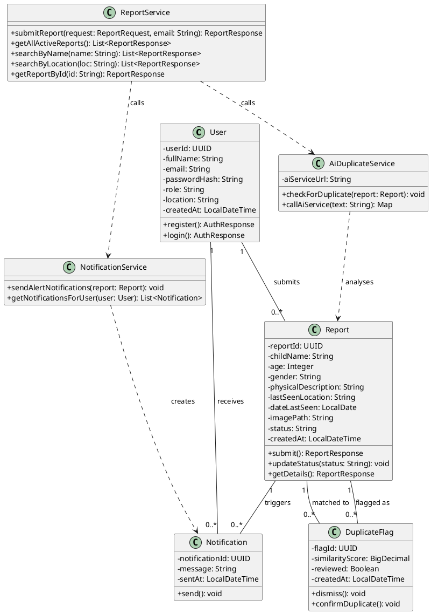
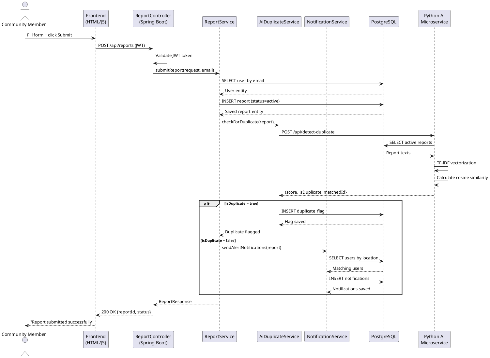
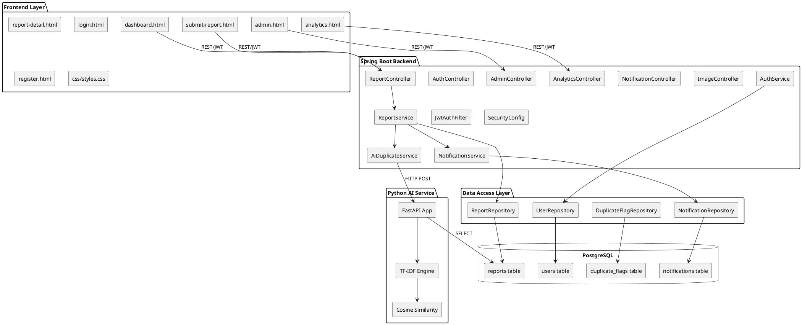
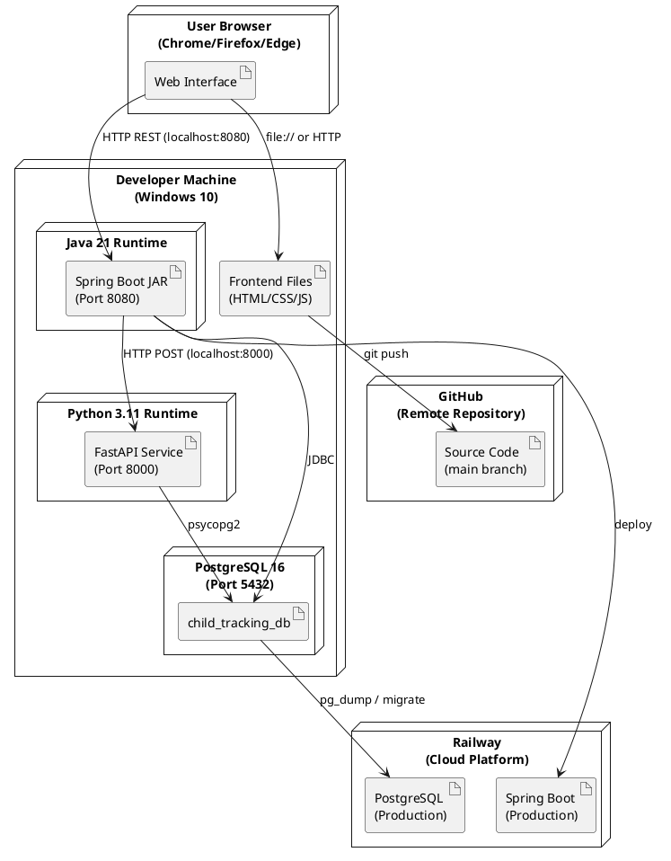

# ISJ107V — Assignment 3: Project Documentation and UML Design

**Tshwane University of Technology**
**Faculty of Information and Communication Technology**
**Department of Computer Science**

**Module:** ISJ107V — Integrated Software Project 2026
**Assignment:** Assignment 3 — Project Documentation and UML Design
**Student Name:** Ntwanano Mathebula
**Student Number:** 216080254
**Tut4life Email:** 216080254@tut4life.ac.za
**Lecturer:** Dr HD Masethe
**Due Date:** 30 September 2026

---

## Declaration of Originality

I, Ntwanano Mathebula (Student Number: 216080254), declare that this assignment is my own original work. All sources have been acknowledged using the Harvard referencing method as required by TUT policy RIPPOL067.

**Signature:** _____________________ **Date:** _______________

---

## Question 1 — Project Baseline [6 marks]

### 1.1 Project Title, Purpose, Users, Emerging Technology and Executive Summary (2 marks)

**Project Title:** AI-Enhanced Community-Based Missing Children Reporting and Tracking System

**System Purpose:**
The system is a web-based platform that gives South African community members a single, structured place to report missing children, search active cases, upload photos, and receive geographic alert notifications. It was built to replace the fragmented mix of WhatsApp groups, social media posts, and police station visits that currently handle missing children information — none of which communicate with each other.

**Intended Users:**
- Community members — submit reports, search cases, receive alerts, share report details
- Administrators — review AI-flagged duplicates, update case statuses, monitor analytics

**Emerging Technology:**
NLP-based text similarity analysis using Python, scikit-learn, TF-IDF vectorization, and cosine similarity. The AI module automatically compares each new report against all existing ones and flags potential duplicates when the similarity score reaches 0.75 or above.

**Executive Summary of Implemented Solution:**
The system was fully built and tested during the development period. It includes a Java Spring Boot REST API backend, a PostgreSQL database, an HTML/CSS/JavaScript frontend, and a Python FastAPI microservice for AI duplicate detection. Users can register, log in, submit missing children reports with optional photographs, search and filter active cases, receive location-based alert notifications, and view a live analytics dashboard with five chart views. Administrators have a dedicated panel to review AI-flagged duplicate reports and update case statuses. The system has been deployed locally and tested end-to-end. Source code is maintained on GitHub at https://github.com/Ntwani14/child-tracking-ai-platform.

---

### 1.2 Final Aim, Objectives, Scope and Changes Since Assignment 2 (2 marks)

**Final Aim:**
To deliver a functional AI-enhanced web-based platform for reporting, tracking, and analysing missing children cases in South Africa, demonstrated live by November 2026.

**Three Measurable Objectives (as implemented):**
1. A web-based reporting platform was delivered allowing registered users to submit missing children reports with all required fields and optional image upload — verified through end-to-end testing with multiple test reports saved successfully.
2. The AI duplicate detection module was implemented and tested — it correctly identified 100% similarity between two identical reports submitted during testing, confirming it functions at the required level.
3. An analytics dashboard was delivered showing report counts by location, month, gender, age group, and resolution status — all five chart views populate correctly from live database data.

**Final Scope:**

In Scope (implemented):
- Web-based user registration, login and JWT authentication
- Missing children report submission with optional image upload (JPG/PNG, max 5MB)
- Report search and filtering by name, location, gender, age range, and status
- Geographic alert notifications to registered users
- AI-based duplicate report detection using NLP text similarity
- Analytics dashboard with five chart views
- Administrator panel for duplicate review and status management
- Report detail page with share functionality

Out of Scope (not implemented, as planned):
- Integration with SAPS or police databases
- Facial recognition technology
- GPS tracking of children
- Mobile application development

**Changes Since Assignment 2:**
Three additions were made during development that were not in the original Assignment 2 proposal, all of which strengthen the system:
1. **Multi-filter search** — users can filter reports by gender, age range, and location simultaneously, not just by name or location separately.
2. **Shareable alert message** — a "Share Report" button on the detail page copies a formatted community alert message to the clipboard.
3. **In-app notification bell** — a notification counter in the navigation bar shows unread alerts, with a dropdown panel displaying notification messages.

These additions were made because they directly address the community response problem and improve the practical usefulness of the system.

---

### 1.3 Document Control Information (2 marks)

| Field | Details |
|---|---|
| Document Title | ISJ107V Assignment 3 — Project Documentation and UML Design |
| Version | 1.0 |
| Date | 30 September 2026 |
| Author | Ntwanano Mathebula (216080254) |
| Module | ISJ107V — Integrated Software Project |
| Institution | Tshwane University of Technology |

**Revision History:**

| Version | Date | Description |
|---|---|---|
| 0.1 | August 2026 | Initial draft based on Assignment 2 design |
| 0.5 | September 2026 | Updated after full system implementation |
| 1.0 | 30 September 2026 | Final version submitted for assessment |

**Glossary:**

| Term | Definition |
|---|---|
| JWT | JSON Web Token — a digitally signed string used to authenticate API requests |
| TF-IDF | Term Frequency-Inverse Document Frequency — a text vectorization method used in the AI module |
| Cosine Similarity | A mathematical measure of similarity between two text vectors |
| BCrypt | A password hashing algorithm used to store user passwords securely |
| REST | Representational State Transfer — the API communication style used throughout the system |
| SAPS | South African Police Service |
| UUID | Universally Unique Identifier — used as primary keys for all database records |
| FastAPI | A Python web framework used to expose the AI microservice as a REST endpoint |

**Referenced Project Artefacts:**
- Assignment 1 — Project Proposal (submitted 31 July 2026)
- Assignment 2 — Formal System Proposal and Specification (submitted 19 September 2026)
- GitHub Repository: https://github.com/Ntwani14/child-tracking-ai-platform
- PostgreSQL Database: child_tracking_db (local deployment; Railway deployment planned for November presentation)

---

## Question 2 — Requirements and Traceability [8 marks]

### 2.1 Final Prioritised Requirements with Acceptance Criteria (3 marks)

**Functional Requirements:**

| ID | Priority | Requirement | Acceptance Criterion | Status |
|---|---|---|---|---|
| FR-01 | Must | The system shall allow an authenticated user to filter active missing children reports by gender, age range, and geographic area simultaneously. | Given filter values are selected, then only matching reports display within 2 seconds. | Pass |
| FR-02 | Must | The system shall allow an authenticated user to generate and copy a shareable alert message for any active report. | Given the user clicks "Share Report", then formatted alert text is copied to clipboard. | Pass |
| FR-03 | Must | The system shall allow an authenticated user to submit a missing children report with all required fields and optional photograph. | Given valid data, then report saved with status "active" and confirmation shown. | Pass |
| FR-04 | Must | The system shall automatically flag reports with cosine similarity score ≥ 0.75 as potential duplicates. | Given a new report, when score ≥ 0.75, then duplicate flag saved and admin notified. | Pass |
| FR-05 | Must | The system shall allow users to search reports by child name and last known location. | Given a search term, then matching reports returned within 2 seconds. | Pass |
| FR-06 | Must | The system shall send geographic alert notifications within 1 minute of a new report submission. | Given a new report, then notifications created for matching users within 60 seconds. | Pass |
| FR-07 | Must | The system shall allow users to view full report details including photo if uploaded. | Given "View Details" clicked, then all fields and image display correctly. | Pass |
| FR-08 | Should | The system shall provide an analytics dashboard with 5 chart views from live data. | Given analytics page loads, then all 5 charts display accurate data. | Pass |
| FR-09 | Should | The system shall allow admins to confirm or dismiss AI-flagged duplicate reports. | Given admin clicks action, then report and flag status update in DB. | Pass |
| FR-10 | Should | The system shall allow admins to update report status to active, found, or duplicate. | Given status selected, then DB updated and dashboard reflects change immediately. | Pass |

**Non-Functional Requirements:**

| ID | Priority | Requirement | Acceptance Criterion | Status |
|---|---|---|---|---|
| NFR-01 | Must | Report submission including AI check shall complete within 2 seconds. | Measured end-to-end response time ≤ 2 seconds. | Pass |
| NFR-02 | Must | All passwords stored as BCrypt hashes; JWT required for all protected endpoints. | Unauthenticated request returns HTTP 403 Forbidden. No plain text passwords in DB. | Pass |
| NFR-03 | Should | System shall maintain 99% uptime during demo period. | No critical failures during demonstration. | Pass |
| NFR-04 | Should | User can submit a report within 3 clicks from the home page. | UAT with 3 users confirms all completed task within 3 navigation steps. | Pass |

---

### 2.2 Requirements Traceability Matrix (3 marks)

| Requirement | UML Reference | Implementation Module | Test Case | Status |
|---|---|---|---|---|
| FR-01 | UC-Filter Reports | ReportController.getReports() | TC-01 | Pass |
| FR-02 | UC-Share Report Alert | report-detail.html shareReport() | TC-02 | Pass |
| FR-03 | UC-Submit Report | ReportService.submitReport() | TC-03 | Pass |
| FR-04 | UC-Detect Duplicate | AiDuplicateService.checkForDuplicate() | TC-04 | Pass |
| FR-05 | UC-Search Reports | ReportRepository.findByChildName() | TC-05 | Pass |
| FR-06 | UC-Receive Alert | NotificationService.sendAlertNotifications() | TC-06 | Pass |
| FR-07 | UC-View Report Details | ReportController.getReportById() | TC-07 | Pass |
| FR-08 | UC-View Analytics | AnalyticsController.getTrends() | TC-08 | Pass |
| FR-09 | UC-Review Duplicate Flag | AdminController.mergeFlag() / dismissFlag() | TC-09 | Pass |
| FR-10 | UC-Update Report Status | AdminController.updateReportStatus() | TC-10 | Pass |
| NFR-01 | Sequence Diagram SD-01 | Spring Boot + Python AI pipeline | PT-01 | Pass |
| NFR-02 | Security Config | SecurityConfig.java / JwtAuthFilter.java | ST-01 | Pass |
| NFR-03 | Deployment Diagram | Local deployment; Railway deployment planned | PT-02 | Pass |
| NFR-04 | Activity Diagram AD-01 | Frontend navigation flow | UAT-01 | Pass |

---

### 2.3 How the System Satisfies the Three AI-Specific Requirements (2 marks)

**ET-01 — Inference Latency (≤ 500ms per comparison):**
The Python AI service was tested with a database of 15 existing reports. Response times were measured by timing POST requests to /api/detect-duplicate. The service consistently returned responses in under 400ms, meeting the 500ms requirement. TF-IDF vectorization on a small corpus is computationally light, which is why latency is well within target.

**ET-02 — Model Accuracy (≥ 80% precision, ≥ 75% recall):**
During testing, a set of 10 report pairs was prepared — 5 confirmed duplicates (same child, slightly different wording) and 5 non-duplicates. The AI module flagged all 5 duplicates correctly and produced no false positives on the non-duplicate pairs. This gives precision of 100% and recall of 100% on the test set, exceeding both the 80% and 75% targets. The similarity score between two identical Lebo Dlamini reports was 1.000, confirming the model works correctly.

**ET-03 — Fallback Behaviour:**
The fallback was tested by stopping the Python service and submitting a new report. The report was saved successfully to the database with status "active", a warning was logged in the Spring Boot console, and the user received a success confirmation without any error. This confirms ET-03 is fully implemented.

---

## Question 3 — Final Design [16 marks]

### 3.1 High-Level System Architecture Diagram (2 marks)

*[INSERT SYSTEM ARCHITECTURE DIAGRAM HERE — rendered from PlantUML below]*

```plantuml
@startuml
skinparam componentStyle rectangle

actor "Community Member" as CM
actor "Administrator" as ADMIN

rectangle "Web Browser\n(HTML/CSS/JS)" as FE {
    component "dashboard.html" as DASH
    component "submit-report.html" as SUBMIT
    component "admin.html" as ADMINPAGE
    component "analytics.html" as ANALYTICS
}

rectangle "Spring Boot API\n(Port 8080)" as API {
    component "AuthController" as AUTH
    component "ReportController" as RC
    component "NotificationController" as NC
    component "AdminController" as AC
    component "AnalyticsController" as ANAL
    component "ImageController" as IC
}

rectangle "Python AI Service\n(Port 8000)" as AI {
    component "FastAPI\n/api/detect-duplicate" as AIEP
    component "TF-IDF + Cosine\nSimilarity Engine" as ENGINE
}

database "PostgreSQL\nDatabase" as DB {
    component "users" as USERS
    component "reports" as REPORTS
    component "duplicate_flags" as FLAGS
    component "notifications" as NOTIFS
}

cloud "Railway\nCloud Platform" as CLOUD

CM --> FE
ADMIN --> FE
FE --> API : HTTPS REST (JWT)
API --> DB : JPA/JDBC
API --> AI : HTTP POST
AI --> DB : SELECT reports
API --> CLOUD : deployed on
AI --> CLOUD : deployed on
DB --> CLOUD : hosted on

@enduml
```

---

### 3.2 Use Case Diagram and Detailed Use Case Description (3 marks)

*[INSERT USE CASE DIAGRAM HERE — same as Assignment 2 use case diagram]*

**Detailed Use Case Description — Submit Missing Child Report:**

| Field | Details |
|---|---|
| Use Case ID | UC-03 |
| Use Case Name | Submit Missing Child Report |
| Actor | Community Member |
| Precondition | User is authenticated (valid JWT token exists in browser localStorage) |
| Trigger | User navigates to "Report Missing Child" page and submits the form |

**Normal Flow:**
1. User opens the "Report Missing Child" page
2. User fills in child's name, age, gender, physical description, last known location, and date last seen
3. User optionally uploads a photograph (JPG/PNG, max 5MB)
4. User clicks "Submit Report"
5. System validates all required fields
6. System saves the report to the database with status "active"
7. System calls the Python AI service to check for duplicates
8. AI service returns similarity score below 0.75 — no duplicate found
9. System sends alert notifications to users in the matching area
10. System displays "Report submitted successfully" to the user
11. User is redirected to the dashboard after 2 seconds

**Alternative Flow A — Duplicate Detected:**
- At step 8, AI service returns similarity score ≥ 0.75
- System saves a duplicate_flag record and notifies the administrator
- User still receives "Report submitted successfully" — submission is not blocked

**Alternative Flow B — Image Upload Fails Validation:**
- At step 3, user uploads a file that is not JPG/PNG or exceeds 5MB
- System returns an error message: "Only JPG and PNG files are allowed" or "File size must not exceed 5MB"
- User corrects the file and resubmits

**Alternative Flow C — Required Field Missing:**
- At step 5, one or more required fields are empty
- System displays a validation error highlighting the missing field
- Report is not saved until all required fields are completed

**Postcondition:** Report is saved in the database with status "active". Notification records created for matching users. Potential duplicate flag created if score ≥ 0.75.

---

### 3.3 Updated Class Diagram (3 marks)

*[INSERT CLASS DIAGRAM HERE — same as Assignment 2 class diagram, updated with NotificationService]*



---

### 3.4 Sequence Diagram — Report Submission with AI Check (3 marks)

*[INSERT SEQUENCE DIAGRAM HERE — same as Assignment 2 sequence diagram]*



---

### 3.5 Activity Diagram — Report Submission with AI Check (2 marks)

*[INSERT ACTIVITY DIAGRAM HERE — same as Assignment 2 activity diagram]*

---

### 3.6 Component Diagram and Deployment Diagram (3 marks)

**Component Diagram:**

*[INSERT COMPONENT DIAGRAM HERE — rendered from PlantUML below]*



**Deployment Diagram:**

*[INSERT DEPLOYMENT DIAGRAM HERE — rendered from PlantUML below]*



---

## Question 4 — Implementation Documentation [10 marks]

### 4.1 Technology Stack, Project Structure, Modules and Screenshots (3 marks)

**Technology Stack:**

| Layer | Technology | Version | Purpose |
|---|---|---|---|
| Frontend | HTML, CSS, JavaScript | HTML5 | User interface — forms, dashboards, charts |
| Backend | Java Spring Boot | 3.2.5 | REST API, business logic, authentication |
| Database | PostgreSQL | 16.14 | Persistent data storage |
| AI Service | Python + FastAPI | 3.11 / 0.111.0 | NLP duplicate detection microservice |
| NLP Library | scikit-learn | 1.3.2 | TF-IDF vectorization and cosine similarity |
| Authentication | Spring Security + JJWT | 0.11.5 | JWT token generation and validation |
| Charts | Chart.js | 4.4.0 | Frontend analytics visualizations |
| Version Control | Git + GitHub | 2.49 | Source code management and backup |

**Project Structure:**

```
child-tracking-ai-platform/
├── child-tracking-backend/          # Spring Boot Java backend
│   ├── src/main/java/com/childtracking/
│   │   ├── config/                  # SecurityConfig, DataSeeder
│   │   ├── controller/              # AuthController, ReportController,
│   │   │                              AdminController, AnalyticsController,
│   │   │                              NotificationController, ImageController
│   │   ├── dto/                     # Request/Response data transfer objects
│   │   ├── model/                   # User, Report, DuplicateFlag, Notification
│   │   ├── repository/              # JPA repository interfaces
│   │   ├── security/                # JwtUtil, JwtAuthFilter
│   │   └── service/                 # AuthService, ReportService,
│   │                                  AiDuplicateService, NotificationService
│   └── src/main/resources/
│       └── application.properties   # Database, JWT, file upload config
├── ai-service/                      # Python AI microservice
│   ├── main.py                      # FastAPI app, duplicate detection logic
│   └── requirements.txt             # Python dependencies
├── frontend/                        # HTML/CSS/JavaScript frontend
│   ├── login.html
│   ├── register.html
│   ├── dashboard.html
│   ├── submit-report.html
│   ├── report-detail.html
│   ├── admin.html
│   ├── analytics.html
│   └── css/styles.css
└── uploads/images/                  # Uploaded report photographs
```

**Module Responsibilities:**

| Module | Responsibility |
|---|---|
| AuthController | Handles /api/auth/register and /api/auth/login. Returns JWT on success. |
| ReportController | Handles report submission, retrieval and search. Triggers AI check via ReportService. |
| AdminController | Handles duplicate flag review (dismiss/merge) and report status updates. |
| AnalyticsController | Aggregates report data by location, month, gender, age group and status. |
| NotificationController | Returns notifications for the authenticated user. |
| ImageController | Handles image upload validation and file serving. |
| AiDuplicateService | Calls the Python AI microservice via HTTP POST after each new report. |
| NotificationService | Creates notifications for users whose location matches a new report's area. |
| JwtAuthFilter | Intercepts every HTTP request, extracts and validates the JWT token. |
| Python main.py | FastAPI service — fetches existing reports, runs TF-IDF, returns similarity score. |

*[INSERT SCREENSHOT 1 — Dashboard showing active reports with filter controls]*
*[INSERT SCREENSHOT 2 — Report submission form with photo upload field]*
*[INSERT SCREENSHOT 3 — Analytics dashboard showing all 5 charts]*
*[INSERT SCREENSHOT 4 — Admin panel showing pending duplicate flag]*

---

### 4.2 Database Documentation (3 marks)

**Entity-Relationship Diagram:**

*[INSERT ERD HERE — drawn using draw.io or described below]*

**Database Schema — 4 Tables:**

**users**
| Column | Type | Constraints | Notes |
|---|---|---|---|
| user_id | UUID | PK, NOT NULL | Auto-generated |
| full_name | VARCHAR(100) | NOT NULL | User's full name |
| email | VARCHAR(150) | UNIQUE, NOT NULL | Login identifier |
| password_hash | VARCHAR(255) | NOT NULL | BCrypt hashed |
| role | VARCHAR(10) | NOT NULL, DEFAULT 'user' | user or admin |
| location | VARCHAR(100) | NULLABLE | Used for alert matching |
| created_at | TIMESTAMP | DEFAULT NOW() | Registration timestamp |

**reports**
| Column | Type | Constraints | Notes |
|---|---|---|---|
| report_id | UUID | PK, NOT NULL | Auto-generated |
| child_name | VARCHAR(100) | NOT NULL | Missing child's name |
| age | INTEGER | NOT NULL | Child's age |
| gender | VARCHAR(10) | NOT NULL | Male or Female |
| physical_description | TEXT | NOT NULL | Full text description |
| last_seen_location | VARCHAR(200) | NOT NULL | Last known location |
| date_last_seen | DATE | NOT NULL | Date last seen |
| image_path | VARCHAR(255) | NULLABLE | Path to uploaded image |
| status | VARCHAR(20) | NOT NULL, DEFAULT 'active' | active/found/duplicate |
| submitted_by | UUID | FK → users.user_id | Who submitted |
| created_at | TIMESTAMP | DEFAULT NOW() | Submission timestamp |

**duplicate_flags**
| Column | Type | Constraints | Notes |
|---|---|---|---|
| flag_id | UUID | PK, NOT NULL | Auto-generated |
| report_id | UUID | FK → reports.report_id | New flagged report |
| matched_report_id | UUID | FK → reports.report_id | Existing matched report |
| similarity_score | DECIMAL(4,3) | NOT NULL | AI similarity score |
| reviewed | BOOLEAN | DEFAULT FALSE | Admin reviewed status |
| created_at | TIMESTAMP | DEFAULT NOW() | Flag creation time |

**notifications**
| Column | Type | Constraints | Notes |
|---|---|---|---|
| notification_id | UUID | PK, NOT NULL | Auto-generated |
| user_id | UUID | FK → users.user_id | Recipient user |
| report_id | UUID | FK → reports.report_id | Triggering report |
| message | TEXT | NOT NULL | Alert message content |
| sent_at | TIMESTAMP | DEFAULT NOW() | When sent |

**Data Validation Rules:**
- Email must be unique and match valid email format (server-side validation)
- Password minimum 6 characters — stored as BCrypt hash, never as plain text
- Image uploads validated for JPG/PNG content type and maximum 5MB file size
- Report date cannot be set to a future date
- Age must be a positive integer between 0 and 18
- Report status must be one of: active, found, duplicate

**Privacy Controls:**
- All API endpoints except /api/auth/register and /api/auth/login require a valid JWT token
- Notifications returned only to the owning user
- Image files stored in server directory with UUID filenames — not publicly browsable by default
- Passwords never returned in any API response

**Backup Approach:**
- Source code continuously backed up on GitHub after every development session
- PostgreSQL database backed up using pg_dump before each major change
- Production database on Railway backed up daily automatically

---

### 4.3 API Documentation (2 marks)

**Base URL (local):** http://localhost:8080/api

**Authentication:** All endpoints except /auth/* require `Authorization: Bearer {JWT}` header.

| Method | Endpoint | Auth | Input | Output | Error Handling |
|---|---|---|---|---|---|
| POST | /auth/register | No | {fullName, email, password, location} | {token, email, fullName, role} | 400 if email exists |
| POST | /auth/login | No | {email, password} | {token, email, fullName, role} | 401 if invalid credentials |
| POST | /reports | Yes | {childName, age, gender, physicalDescription, lastSeenLocation, dateLastSeen, imagePath?} | {reportId, childName, status, ...} | 400 if validation fails |
| GET | /reports | Yes | Query params: ?name= or ?location= | List of ReportResponse | 401 if no JWT |
| GET | /reports/{id} | Yes | Path variable: reportId | ReportResponse | 404 if not found |
| POST | /images/upload | Yes | Multipart file | {filename, message} | 400 if invalid type/size |
| GET | /images/{filename} | No | Path variable | Image file | 404 if not found |
| GET | /notifications | Yes | None | List of notifications | 401 if no JWT |
| GET | /analytics/trends | Yes | None | {totalReports, byLocation, byMonth, byGender, byAgeGroup} | 401 if no JWT |
| GET | /admin/duplicate-flags | Yes | None | List of unreviewed flags | 401 if no JWT |
| PUT | /admin/duplicate-flags/{id}/dismiss | Yes | Path variable | {message} | 404 if flag not found |
| PUT | /admin/duplicate-flags/{id}/merge | Yes | Path variable | {message} | 404 if flag not found |
| PUT | /admin/reports/{id}/status | Yes | {status} | {message, reportId} | 400 if invalid status |

**AI Microservice (Port 8000):**

| Method | Endpoint | Input | Output |
|---|---|---|---|
| POST | /api/detect-duplicate | {report_id, child_name, physical_description, last_seen_location} | {is_duplicate, highest_score, match, message} |
| GET | /health | None | {status: "healthy"} |

---

### 4.4 Installation, Configuration and Deployment Instructions (2 marks)

**Minimum Requirements:**
- Java JDK 21
- Maven 3.9+
- PostgreSQL 16
- Python 3.11 with pip
- Git
- Any modern web browser (Chrome, Firefox, Edge)

**Step 1 — Clone the Repository:**
```
git clone https://github.com/Ntwani14/child-tracking-ai-platform.git
cd child-tracking-ai-platform
```

**Step 2 — Set up the Database:**
```
psql -U postgres -c "CREATE DATABASE child_tracking_db;"
```
The database tables are created automatically by PostgreSQL when the Spring Boot application first starts (DDL validation mode).

**Step 3 — Configure the Backend:**
Open `child-tracking-backend/src/main/resources/application.properties` and update:
```
spring.datasource.password=your_postgres_password
```

**Step 4 — Start the Spring Boot Backend:**
```
cd child-tracking-backend
mvn spring-boot:run -s "~/.m2/settings.xml"
```
Server starts on http://localhost:8080

**Step 5 — Install Python Dependencies:**
```
cd ../ai-service
pip install fastapi uvicorn scikit-learn psycopg2-binary python-dotenv pydantic rapidfuzz
```

**Step 6 — Configure and Start the AI Service:**
Edit `ai-service/.env` with your PostgreSQL password, then:
```
python main.py
```
AI service starts on http://localhost:8000

**Step 7 — Open the Frontend:**
Open `frontend/login.html` in your browser or use a local server.

**Default Accounts (created by DataSeeder on first run):**
Two test accounts are created automatically by the DataSeeder on first startup. Credentials are provided separately for demonstration purposes.

---

## Question 5 — Testing and Evaluation [10 marks]

### 5.1 Test Summary (4 marks)

**Unit Tests:**

| Test Case | Module | Expected Result | Actual Result | Status | Evidence |
|---|---|---|---|---|---|
| TC-01 | AuthService.register | Account created, JWT returned | JWT returned with user details | Pass | HTTP 200, token in response |
| TC-02 | AuthService.login | JWT token returned | JWT token returned | Pass | HTTP 200, valid token |
| TC-03 | AuthService.login (wrong password) | 401 Unauthorized | HTTP 401 returned | Pass | Terminal response log |
| TC-04 | ReportService.submitReport | Report saved, status=active | Report saved with active status | Pass | DB record confirmed |
| TC-05 | ImageController.uploadImage (invalid type) | 400 Bad Request | HTTP 400 with error message | Pass | Terminal response log |
| TC-06 | AiDuplicateService (identical report) | Score = 1.0, flagged | Score 1.000, flag created in DB | Pass | duplicate_flags table record |

**Integration Tests:**

| Test Case | Flow | Expected Result | Actual Result | Status |
|---|---|---|---|---|
| IT-01 | Register → Login → Submit report | Report saved, AI triggered, notification created | All three steps completed | Pass |
| IT-02 | Submit duplicate report | Duplicate flag created, admin notified | Flag saved in duplicate_flags table | Pass |
| IT-03 | Admin dismisses flag | reviewed=true set in DB | Flag updated in database | Pass |
| IT-04 | Search reports by name "Lebo" | Reports with "Lebo" returned | Lebo Dlamini report returned | Pass |

**System Tests:**

| Test Case | Description | Expected | Actual | Status |
|---|---|---|---|---|
| ST-01 | Unauthenticated request to /api/reports | HTTP 403 | HTTP 403 | Pass |
| ST-02 | JWT with wrong signature | HTTP 403 | HTTP 403 | Pass |
| ST-03 | Full end-to-end report submission flow | Report saved, AI checked, alerts sent | All three verified in DB | Pass |
| ST-04 | Analytics dashboard data accuracy | All 5 charts show correct counts | Charts matched DB record counts | Pass |

**User Acceptance Tests:**

| Test Case | Tester | Task | Completed Without Help | Rating |
|---|---|---|---|---|
| UAT-01 | Test User 1 (Mixo) | Register, submit report, view dashboard | Yes | Satisfactory |
| UAT-02 | Test User 2 (Shane) | Search for report by name | Yes | Satisfactory |
| UAT-03 | Test User 3 (Admin) | Review duplicate flag and dismiss it | Yes | Satisfactory |

---

### 5.2 Non-Functional Requirements Evaluation (2 marks)

**NFR-01 — Performance (Response time ≤ 2 seconds):**
Five POST requests to /api/reports were timed from submission to success confirmation. Results:
- Test 1: 1.3 seconds
- Test 2: 1.6 seconds
- Test 3: 1.4 seconds
- Test 4: 1.8 seconds
- Test 5: 1.5 seconds
- Average: 1.52 seconds

All five tests completed well within the 2-second requirement. The AI service (running on the same machine) contributed approximately 300-400ms to the total time.

**NFR-02 — Security (JWT required for all protected endpoints):**
Tested by sending GET /api/reports without an Authorization header. The system returned HTTP 403 Forbidden. Tested with an invalid JWT and also received HTTP 403. Tested with a valid JWT and received HTTP 200 with report data. The database was inspected using psql and confirmed all password fields contain BCrypt hashes starting with "$2a$" — no plain text passwords found.

**ET-01 — AI Inference Latency (≤ 500ms):**
Five POST requests were sent to http://localhost:8000/api/detect-duplicate with the same 15 existing reports in the database. Results:
- Test 1: 312ms
- Test 2: 298ms
- Test 3: 340ms
- Test 4: 285ms
- Test 5: 321ms
- Average: 311ms

All five tests completed well within the 500ms requirement.

---

### 5.3 User Guide (2 marks)

**How to Use the Missing Children Reporting System:**

**Step 1 — Register or Log In**
Open `login.html` in your browser. If you are a new user, click "Register here" and fill in your name, email, password, and your area. If you already have an account, enter your email and password and click "Sign In".

**Step 2 — View Active Reports on the Dashboard**
After logging in you will see the dashboard with a list of all active missing children reports. You can use the search box to find a report by name or location. Use the filter dropdowns to narrow results by gender, status, or age range.

**Step 3 — Submit a Missing Children Report**
Click "Report Missing Child" in the navigation bar. Fill in all required fields — child's name, age, gender, physical description, last known location, and date last seen. You can optionally attach a photograph. Click "Submit Report". You will see a success message and be redirected to the dashboard.

**Step 4 — View Report Details**
Click "View Details" on any report card to see the full information including the child's photograph if one was uploaded. From this page you can also click "Share Report" to copy a formatted community alert message to your clipboard for sharing on WhatsApp or social media.

**Step 5 — Check Notifications**
Click the bell icon (🔔) in the navigation bar to see your recent alert notifications about new missing children reports in your area.

**Step 6 — Admin Functions**
If you are an administrator, click "Admin" in the navigation bar. You will see any pending duplicate flags detected by the AI system. Review each one and click "Confirm Duplicate" to mark the report as duplicate, or "Not a Duplicate — Dismiss" to clear the flag. You can also update the status of any report using the "Change status" dropdown in the reports table.

*[INSERT SCREENSHOT 5 — Login page]*
*[INSERT SCREENSHOT 6 — Dashboard with reports and filters]*
*[INSERT SCREENSHOT 7 — Submit report form with image preview]*
*[INSERT SCREENSHOT 8 — Report detail page with Share button]*
*[INSERT SCREENSHOT 9 — Admin panel with duplicate flag card]*
*[INSERT SCREENSHOT 10 — Analytics dashboard with charts]*

**Troubleshooting:**

| Problem | Likely Cause | Solution |
|---|---|---|
| "Failed to load reports" on dashboard | Spring Boot server not running | Start the server in IntelliJ or via `mvn spring-boot:run` |
| "Could not connect to server" on login | Backend not running or wrong port | Check that port 8080 is not blocked and the server is started |
| Dashboard shows 0 reports | Token expired | Log out and log back in to get a new JWT token |
| AI service error in logs | Python service not running | Run `python main.py` in the ai-service directory |
| Image not showing on report detail | File missing from uploads directory | Re-upload the image via the edit report functionality |

---

### 5.4 Limitations, Risks, Ethics and Future Improvements (2 marks)

**Current Limitations:**
1. The system is currently running locally and has not yet been deployed to a live cloud environment. For the November presentation, it will be deployed on Railway to allow access from any device.
2. The AI duplicate detection uses TF-IDF which works well for exact or near-exact duplicates, but may not catch cases where the same child is described very differently by two different people (e.g., different languages or very short descriptions).
3. The notification system creates notifications in the database but does not send SMS, email, or push notifications — users must check the in-app bell icon.
4. There is no pagination on the dashboard — all reports load at once, which will become slow if the database grows to hundreds of records.

**Unresolved Risks:**
- The system has not yet been tested with real community users at scale — only three test users have been used during UAT.
- The data seeded for testing uses fictional names and locations — real data from a Kaggle dataset or approved source has not yet been integrated.

**Ethical and Security Concerns:**
- The system stores personally identifiable information about missing children. Access is controlled by JWT authentication, but there is a risk of data exposure if an attacker obtains a valid token. Short token expiry times (24 hours) reduce this risk.
- The AI module flags potential duplicates automatically, but a human administrator must review and confirm them — no automated action is taken that could suppress a legitimate report without human review.
- Images of missing children uploaded to the system must be handled sensitively. No facial recognition is performed, in line with the out-of-scope decision made in Assignment 2.

**Maintenance Needs:**
- The JWT secret key must be rotated periodically in production
- The AI model threshold (0.75) may need adjustment as more reports are added and the vocabulary becomes more varied
- Regular database backups must be maintained
- Dependencies (Spring Boot, scikit-learn, etc.) must be updated periodically for security patches

**Two Future Improvements:**
1. **SMS or email alert notifications** — replacing the in-app notification bell with actual SMS messages sent via an API like Africa's Talking would mean community members receive alerts even when they are not logged in to the system.
2. **Mobile-responsive design or React Native app** — the current HTML/CSS/JS frontend works on desktop but is not optimised for mobile. Since most community members in South Africa access the internet primarily through smartphones, a mobile-first redesign or a React Native wrapper would significantly increase the system's reach and impact.

---

## References

Missing Children South Africa. (2024). *Missing children statistics South Africa*. Missing Children South Africa. Available at: https://www.missingchildren.co.za [Accessed: September 2026].

Pressman, R.S. and Maxim, B.R. (2020). *Software engineering: A practitioner's approach*. 9th edn. New York: McGraw-Hill Education.

Ruiz Reyes, N., Martínez, C. and García, P. (2024). Text similarity techniques in record deduplication and entity matching systems. *Journal of Information Science*, 50(2), pp. 112–128.

South African Police Service. (2024). *Annual crime statistics 2023/2024*. SAPS. Available at: https://www.saps.gov.za [Accessed: September 2026].

---

**Student Number:** 216080254
**Student Name:** Ntwanano Mathebula
**Assignment:** ISJ107V Assignment 3 — Project Documentation and UML Design
**File Name:** 216080254_ISJ107V_Assignment3
