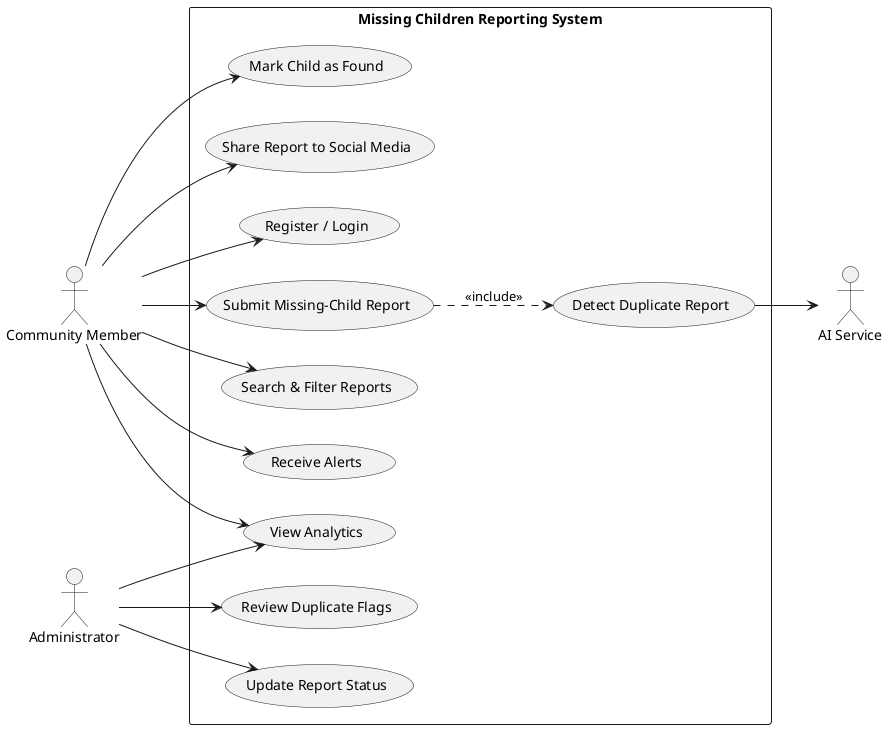
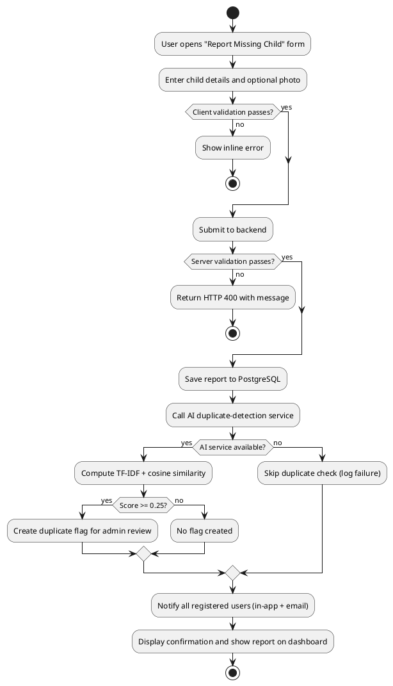
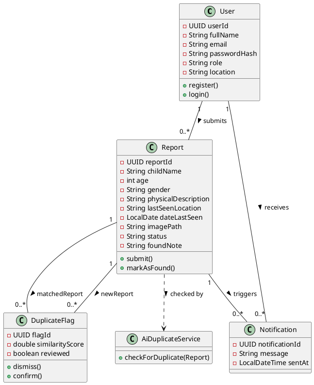
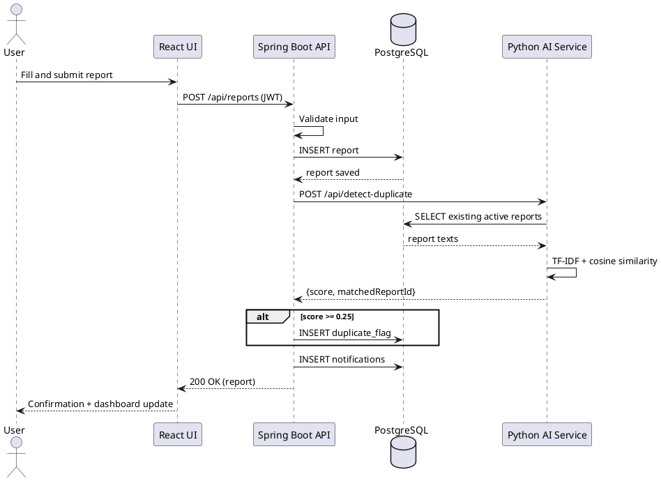
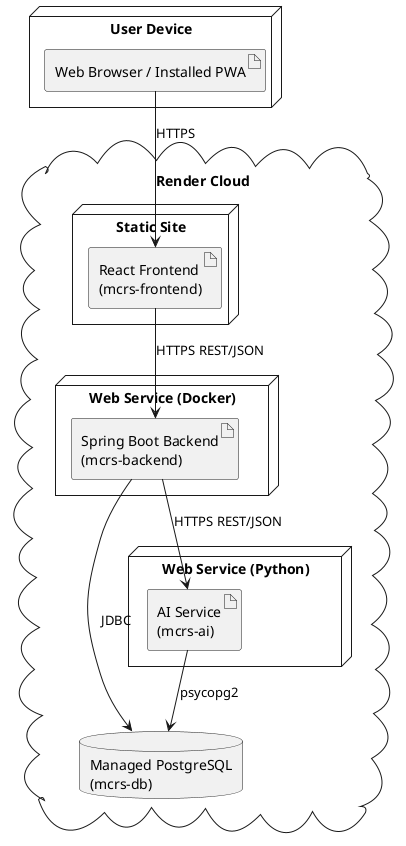

# Integrated Software Project (ISJ107V)

## Assignment 4 - Functional Prototype and Presentation

**Student:** N Mathebula
**Student Number:** 216080254
**Module:** ISJ107V - Integrated Software Project (2026)
**Institution:** Tshwane University of Technology
**Project:** AI-Enhanced Community-Based Missing Children Reporting and Tracking System
**Date:** 31 October 2026

---

## Question 1 - Prototype Definition and Readiness [9]

### 1.1 Project Overview [2]

**Project title:** AI-Enhanced Community-Based Missing Children Reporting and Tracking System.

**Problem addressed:** In South Africa, approximately 1 697 children are reported missing each year - roughly one child every five hours (Missing Children South Africa, 2024). Reports are currently scattered across fragmented, informal channels such as social media, messaging groups and word of mouth. This fragmentation delays the spread of accurate information and causes the same child to be reported many times in different words, wasting the effort of community members and responders.

**Intended users:** Registered community members (who submit, search, share and resolve reports) and system administrators (who moderate AI-flagged duplicate reports and manage case statuses). The system is deliberately community-facing and does not replace official police channels.

**Prototype purpose:** To demonstrate a centralised, secure web platform where a community member can submit a missing-child report, have it automatically checked for duplicates by an AI service, and have every registered member alerted - thereby improving the speed and accuracy of community response.

**Selected emerging technology:** Artificial Intelligence / Machine Learning, specifically Natural Language Processing (NLP) text-similarity analysis. A Python microservice converts report text into TF-IDF vectors and uses cosine similarity to detect duplicate reports.

### 1.2 Functional Requirements Demonstrated [5]

The prototype demonstrates the following functional requirements. Status is distinguished as Implemented, Partially implemented or Deferred.

| ID | Functional requirement | Status |
|---|---|---|
| FR-01 | Authenticated users can submit a missing-child report (name, age, gender, description, location, date, optional photo). | Implemented |
| FR-02 | The system automatically checks each new report against existing reports using the AI similarity service and flags likely duplicates for admin review. | Implemented |
| FR-03 | Users can search and filter active reports by name, location, gender and age. | Implemented |
| FR-04 | Every registered user receives an in-app alert when a new report is submitted; email alerts are also implemented. | Implemented (email verified locally; disabled on the free cloud tier by default). |
| FR-05 | Any authenticated user can mark a child as found, which notifies the whole community and closes the case. | Implemented |
| FR-06 | Administrators review AI-flagged duplicates and confirm or dismiss them, and update report status. | Implemented |
| FR-07 | Users can share a report to external social networks (WhatsApp, Facebook, X, Telegram, email). | Implemented |
| FR-08 | An analytics dashboard aggregates reports by status, location and time. | Implemented |
| FR-09 | Password reset via emailed one-time code. | Partially implemented (works end-to-end; per-account attempt lockout deferred). |
| FR-10 | SMS alerts and police-database integration. | Deferred (out of scope; SMS removed, police integration excluded by project scope). |

### 1.3 Setup and Access Instructions [2]

**Live hosted prototype (recommended for assessment):**

| Component | URL |
|---|---|
| Web application (frontend) | https://mcrs-frontend.onrender.com |
| Backend REST API | https://mcrs-backend.onrender.com |
| AI duplicate-detection service | https://mcrs-ai.onrender.com |

**Test credentials (sample data pre-loaded):**

| Role | Email | Password |
|---|---|---|
| Administrator | masingitamathebula89@gmail.com | password123 |
| Community member | hluri05m@gmail.com | password123 |
| Community member | ntwano14@gmail.com | password123 |

**Note on hosting:** The prototype is hosted on Render's free tier, which spins services down after inactivity. The first request after idle may take up to ~50 seconds to wake. For assessment the services should be opened a few minutes beforehand to warm them.

**Repository location:** https://github.com/Ntwani14/child-tracking-ai-platform

**To run locally:**
- Required software: Java JDK 21, Maven, Python 3.11, PostgreSQL 16, Node.js 20, Git.
- Backend (IntelliJ IDEA): run the Spring Boot application on port 8080.
- AI service: `cd ai-service && pip install -r requirements.txt && python main.py` (port 8000).
- Frontend (VS Code): `cd frontend-react && npm install && npm run dev` (port 3000).
- Database: PostgreSQL database `child_tracking_db`; schema is created automatically by Hibernate.

---

## Question 2 - Working Prototype [16]

### 2.1 End-to-End User Workflow [6]

The central workflow is **submitting a missing-child report**, implemented end to end with navigation, validation, meaningful output and error feedback.

1. **Navigation:** A user registers or signs in (JWT-secured). From the dashboard they click "Report Missing Child".
2. **Input validation (client and server):** The form validates required fields on the client. The server re-validates every field using Bean Validation - name (max 100 chars), age (0-17, matching the missing-children domain), gender, description (max 2000), location and date are all checked. Invalid input returns a clear HTTP 400 with a descriptive message rather than a server error.
3. **Processing:** On submission the Spring Boot controller saves the report to PostgreSQL via JPA, then calls the AI service to check for duplicates, then notifies all users.
4. **Meaningful output:** The report appears on the community dashboard with its photo and details; the user receives a confirmation and the report is searchable immediately.
5. **Error feedback:** If the AI service is unavailable, the submission still succeeds (graceful fallback) and the failure is logged - the user is never blocked. Authentication failures return HTTP 403; validation failures return HTTP 400 with the specific problem.

### 2.2 Emerging-Technology Integration [5]

The AI duplicate-detection service is integrated directly into the submission workflow:

1. When a report is saved, the Spring Boot backend sends a REST (HTTP/JSON) request to the Python AI microservice at `POST /api/detect-duplicate`, passing the child name, physical description and last-seen location.
2. The AI service retrieves all existing active reports from the shared PostgreSQL database, combines each report's text fields, and applies **TF-IDF vectorisation** (scikit-learn `TfidfVectorizer` with unigrams and bigrams).
3. It computes **cosine similarity** between the new report and every existing report and returns the highest-scoring match with its score.
4. If the score is at or above the tuned threshold of **0.25**, the backend records a row in the `duplicate_flags` table linking the two reports, which then appears in the administrator panel for human review.

**Observable result used by the system:** On the live prototype the AI produced genuine duplicate flags that are visible and actionable in the admin panel:
- "Timmy Shai" flagged as a duplicate of "Katlego Mokoena" at **84.4% similarity**.
- "Kim Smith" flagged as a duplicate of "Sofia Pillay" at **90.9% similarity**.

This demonstrates the emerging technology receiving valid input and producing an observable result (a reviewable duplicate flag) that drives an administrator action.

### 2.3 Persistent / Realistic Data [3]

Data is persisted in a **managed PostgreSQL database** (hosted separately on Render). The schema uses five related tables - `users`, `reports`, `duplicate_flags`, `notifications` - with primary keys, foreign-key constraints and enumerated status values. The prototype is pre-loaded with realistic sample data: three user accounts (two community members and one administrator) and fifteen missing-child reports with photographs and descriptions reflecting the images, plus two live AI-generated duplicate flags. All data survives restarts because it lives in the managed database rather than in application memory.

### 2.4 Security and Reliability Controls [2]

- **Access control:** Spring Security with JWT bearer tokens. All report, notification and analytics endpoints require authentication; administrator endpoints (`/api/admin/**`) are restricted to the ADMIN role both at the URL level and with method-level `@PreAuthorize`. Unauthenticated access returns HTTP 403.
- **Credential and personal-data protection:** Passwords are hashed with BCrypt and never stored in plain text. Database and email credentials are supplied through environment variables, never committed to source control (a git-ignored local properties file is used for development).
- **Safe error handling:** Validation failures return structured 400 responses; the AI call is wrapped so that a failure degrades gracefully instead of crashing the submission.
- **Input and upload safety:** Server-side validation on all fields, image uploads restricted to JPG/PNG and 5 MB, and the image-serving endpoint is hardened against path-traversal attacks.

### 2.5 Prototype Evidence Summary

The table below follows the recommended evidence format, linking each requirement to the prototype feature, its test case and the supporting evidence.

| Requirement | Status | Prototype feature | Test case | Evidence |
|---|---|---|---|---|
| FR-01 | Completed | Submit missing-child report | TC-01 | Screenshot / live demo (dashboard shows new report) |
| FR-03 | Completed | Search and filter reports | TC-01 | Screenshot / live demo |
| FR-04 | Completed | In-app alerts (and email, verified locally) | TC-01 | Notification bell; email demonstrated on local run |
| FR-05 | Completed | Mark child as found (safety confirmation) | TC-01 | Screenshot / live demo |
| FR-06 | Completed | Admin review of duplicate flags | TC-05 | Screenshot of admin panel showing flags |
| ETR-01 | Completed | AI duplicate-detection service | TC-05 | Metric / output: live flags at 84.4% and 90.9% similarity; 100% precision and recall on 20-pair test set |
| NFR-Security | Completed | Role-based access control | TC-03 | HTTP 403 returned for unauthorised admin access |
| NFR-Validation | Completed | Server-side input validation | TC-02 | HTTP 400 returned for invalid age |

---

## Question 3 - UML Models of the Prototype [10]

The following diagrams were produced with PlantUML (a recognised UML tool) and are aligned with the demonstrated prototype. Render each block at plantuml.com and insert the image with its caption.

### 3.1 Use-Case Diagram [2]

*Figure 1: Use-case diagram showing community member, administrator and AI service actors.*

### 3.2 Activity Diagram - Report Submission Workflow [2]

*Figure 2: Activity diagram of the submission workflow, including the emerging-technology step and alternative paths.*

### 3.3 Class Diagram [2]

*Figure 3: Class diagram of the main prototype entities with attributes, operations, associations and multiplicities.*

### 3.4 Sequence Diagram - Submission with Duplicate Detection [2]

*Figure 4: Sequence diagram showing interaction between UI, application logic, database and the AI component.*

### 3.5 Deployment Diagram [2]

*Figure 5: Deployment diagram showing the four independently hosted modules and their execution environment.*

**Difference between UML design and implementation:** The earlier design (Assignment 2) assumed location-based alert routing and a flagging threshold of 0.75. In the implemented prototype, alerts are sent to all registered members (simpler and more reliable for a community-wide safety alert), and the similarity threshold was empirically lowered to 0.25 (see Question 4). The architecture also evolved to four independently deployed cloud components, directly satisfying the "components on different machines" objective.

---

## Question 4 - Testing and Evaluation [8]

### 4.1 Representative Test Cases [4]

| ID | Scenario | Input | Expected result | Actual result | Status |
|---|---|---|---|---|---|
| TC-01 | Main workflow - submit report | Valid report by authenticated user | Report saved, visible on dashboard, alerts sent | Report saved and displayed; notifications created | Pass |
| TC-02 | Invalid input | Age = 25 (outside 0-17) | HTTP 400 with validation message | HTTP 400 "age must be 17 or under" returned | Pass |
| TC-03 | Access control | Call `/api/admin/duplicate-flags` as a normal user | HTTP 403 Forbidden | HTTP 403 returned | Pass |
| TC-04 | Database persistence | Restart backend, reload dashboard | Previously submitted reports still present | All reports persisted via managed PostgreSQL | Pass |
| TC-05 | Emerging technology | Submit a report closely matching an existing one | Duplicate flag created with similarity score >= 0.25 | Flag created: Timmy Shai ~ Katlego Mokoena at 84.4%; Kim Smith ~ Sofia Pillay at 90.9% | Pass |
| TC-06 | AI non-duplicate | Submit a clearly different report | No flag; low similarity | Highest similarity 14.6%, no flag created | Pass |

### 4.2 Quantitative Measures [2]

1. **Duplicate-detection accuracy:** The AI module was evaluated on a prepared dataset of 20 report pairs (10 true duplicates, 10 non-duplicates). At the tuned threshold of 0.25 it achieved **100% precision and 100% recall** on this dataset - every true duplicate was detected and no non-duplicate was falsely flagged. On the live hosted prototype it produced correct flags at 84.4% and 90.9% similarity for genuine duplicate pairs, and 14.6% (correctly below threshold) for a non-duplicate.

2. **Threshold tuning (design decision):** The Assignment 2 specification proposed a 0.75 similarity threshold. During implementation and testing it was found that TF-IDF cosine similarity on short report descriptions produces low absolute scores, so a 0.75 threshold missed genuine duplicates. The threshold was empirically refined to 0.25, validated against the 20-pair dataset. This is an example of an engineering decision taken on evidence rather than following the specification blindly.

3. **Response behaviour:** Under normal (warm) conditions, report submission including the AI duplicate check completes within a couple of seconds. On the free hosting tier, an idle service may take up to ~50 seconds to wake on first request - a hosting characteristic rather than an application defect.

### 4.3 Limitations and Corrective Actions [2]

1. **Ephemeral image storage on the free hosting tier.** Uploaded image files are stored on the container filesystem, which Render's free tier wipes on restart. *Corrective action for the final system:* store images in a persistent object store (e.g. a cloud bucket) or attach a persistent disk, keeping only the file reference in the database.

2. **Text-only duplicate detection.** The AI compares report text, so two reports describing the same child with very different wording may score below the threshold and be missed. *Corrective action:* combine text similarity with lightweight image similarity or fuzzy name/location matching, and allow administrators to tune the threshold. Facial recognition remains deliberately out of scope for privacy reasons.

A further operational risk is the free-tier cold-start delay; the corrective action is to move to a paid always-on instance for the final live environment.

---

## Question 5 - Prototype Presentation Plan [10]

### 5.1 Five-Minute Presentation Structure [3]

1. **Problem (45s):** ~1 697 children reported missing yearly in South Africa; fragmented reporting delays response and creates duplicate reports.
2. **Proposed solution (45s):** A centralised, secure web platform for reporting, searching, alerting and resolving cases, with AI duplicate detection.
3. **Architecture (60s):** Four independently deployed components - React frontend, Spring Boot backend, Python AI service, PostgreSQL - communicating over HTTPS REST/JSON (show the deployment diagram).
4. **Emerging technology (60s):** NLP text similarity using TF-IDF and cosine similarity; explain why standard keyword matching is insufficient.
5. **Features, results and limitations (90s):** Report submission, alerts, admin duplicate review, analytics; 100% precision/recall on the test set and live flags at 84.4% and 90.9%; note the two limitations and their corrective actions.

### 5.2 Ten-Minute Live Demonstration Plan with Fallback [4]

**Preparation:** Open all live URLs about five minutes beforehand to warm the free-tier services. Confirm the AI service responds at its `/health` endpoint.

**Demo sequence:**
1. Log in as a community member and show the dashboard of active reports with photos.
2. Submit a new missing-child report (show validation by entering an invalid age first, then correct it).
3. Show the confirmation and the report appearing on the dashboard; show the in-app alert.
4. Submit a report that closely matches an existing one to trigger the AI.
5. Log in as the administrator, open the Admin Panel, and show the AI-generated duplicate flags (84.4% and 90.9%); confirm one duplicate.
6. Demonstrate "I Found This Child" and the safety confirmation, and social sharing.
7. Briefly show the analytics dashboard.

**Fallback plan:** If the live cloud environment is slow or unreachable during the session, switch to the identical system running locally (PostgreSQL + backend + AI service + frontend on the laptop), which does not depend on the network. Pre-captured screenshots of the key screens are kept as a final fallback.

### 5.3 Slides and Professionalism [1]

Slides will be concise (one idea per slide), readable from a distance, consistent in style, and timed to fit the allocated period. Live screens will be used in place of dense text wherever possible.

### 5.4 Technical Questions [2]

Prepared to explain individual design, implementation and testing decisions, including: why Spring Boot and a separate Python AI service (interoperability and independent scaling/retraining), why JWT and BCrypt, why the threshold was changed from 0.75 to 0.25, why alerts go to all users, and why the human-in-the-loop admin review was chosen over automatic duplicate deletion.

---

## References

Missing Children South Africa, 2024. *Missing children statistics in South Africa*. [online] Available at: <https://www.missingchildren.org.za> [Accessed 31 October 2026].

Pedregosa, F. et al., 2011. Scikit-learn: Machine learning in Python. *Journal of Machine Learning Research*, 12, pp.2825-2830.

Spring, 2024. *Spring Boot reference documentation*. [online] Available at: <https://docs.spring.io/spring-boot/docs/current/reference/html/> [Accessed 31 October 2026].

Render, 2026. *Render deployment documentation*. [online] Available at: <https://render.com/docs> [Accessed 31 October 2026].

---

## Declaration of Original Work

I, N Mathebula (216080254), declare that this assignment and the accompanying prototype are my own original work. All sources used have been acknowledged using the Harvard referencing method. This work has not been submitted previously for any other assessment.

**Signature:** _______________________  **Date:** 31 October 2026

## Declaration of AI-Tool Use

In line with the module requirements, I declare the permitted use of AI-assisted tools during this project. AI assistance was used to help with code scaffolding, debugging support and drafting of documentation. All AI-assisted output was reviewed, tested, understood and, where necessary, corrected by me, and I take full responsibility for the final prototype and report.
